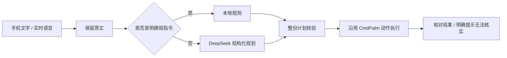

# CmdPalm AI（龙虾脑新基础）

基于 [CmdPalm v0.6.0](https://github.com/rahatsagor/CmdPalm/releases/tag/v0.6.0) 的独立分支。保留原版触控板、键盘、Deck、配对与重连；增加手机语音指令和自然语言助手。上游提交为 `d7b2691c1095e9aa9a344a7dbd31a4fca667d2cd`。

本版是 **0.7.0 开发验收版**，优先做好基本操作。原项目完整说明保留在 [README.upstream.md](README.upstream.md)。沿用 AGPL-3.0-only，作者及许可见 [LICENSE](LICENSE)。

## 使用流程

Mac 启动 CmdPalm AI，按系统提示授予辅助功能权限。在“AI 与语音”中配置 Key，手机扫码配对。原版遥控页面仍可直接使用，无需 LLM。

在“助手”输入或说出指令。语音边说边显示，点“结束”后自动理解与执行，**没有额外“开始转写”按钮**。要把一段话原样写进 Mac，请说“输入……”；纯文本听写也可使用原版“Keyboard”。“你好”作为助手问候不会操作电脑。

| 可以先验收 | 当前边界 |
| --- | --- |
| 打开、切换、隐藏、退出指定应用 | 不选择聊天对象或自动发送消息 |
| 向当前输入框输入中英文原文 | 不自动判断应编辑哪份文档；先确认 Mac 中的目标窗口与输入位置 |
| 指定浏览器打开网页、搜索 | 不根据搜索结果自动点击或读取内容 |
| 打开下载、桌面、文档、个人文件夹 | 不删除文件，不清空废纸篓 |
| 音量、常见编辑与窗口快捷操作 | 部分操作无法读回结果，会明确显示“请核对” |
| 明确的多步指令、补充对象后继续理解 | 断线与取消后不自动重做动作 |

手机浏览器直接录音需要 HTTPS。局域网 HTTP 可先测文字和遥控；HTTPS 可使用 CmdPalm 原版证书流程，或配置你自己的 HTTPS 代理。公网模式须关闭 PIN 配对与陌生设备申请，只使用私人的一次性扫码配对；已配对设备会记住自己的令牌。

## 意图如何实现



提示词负责理解日常说法、否定、上下文与步骤关系；程序限定真实应用、动作参数、顺序和能力边界。模型不能直接执行脚本、任意键鼠或自动回车发消息。非法计划在第一步之前整份拒绝。

文字执行前，Mac 尝试在本机记录输入位置与预期变化，执行后核对完整结果；读不到输入位置时保留原版输入能力，结果标为未核实。正文不会因为模型推理被翻译、润色或拆成其它命令。

## 语音与模型选择

默认理解服务使用现有 DeepSeek Key，模型 `deepseek-flash`，关闭思考模式。阿里云 `qwen3-asr-flash-realtime` 负责识别音频，**DeepSeek 不负责直接识别音频**。原版 Mac Apple 本机识别可在设置中切回；iPhone 键盘自带听写也能直接用于文字输入。

云端语音最多预热一个连接，空闲 20 秒关闭。预热不打开麦克风、不上传音频；录音仍由用户点击开始。音频以 20 毫秒 PCM 帧传输，并确认最后一帧后结束。错误、断线和录音被打断时保留草稿，不执行未完整确认的语音。

[模型与语音评测](docs/验收记录.md)包含合成样本、失败用例、测量口径和费用来源。测试结果是本次样本的结果，不代表所有日常语言都能成功，也不代表 iPhone 真人语音准确率。

## 构建与配置

标准 Xcode 构建沿用 [CONTRIBUTING.md](CONTRIBUTING.md) 和 `scripts/build-app.sh`。

本机另提供 `python3 scripts/build-local.py`，使用指定的 Command Line Tools SDK、Rust、Bun 编译全部源码，并复用经过官方 SHA-256 校验的上游图标及框架资源。当前机器的隔离工具位于忽略目录 `local-cache/tools`；脚本不会全局安装 Xcode、修改 xcode-select 或关闭 Gatekeeper。这个本机脚本目前仅适配 Apple Silicon 和 SDK 26.5。

固定签名沿用上游 `scripts/make-signing-identity.sh`。创建后构建会使用该身份，避免临时签名在每次构建时变化。签名私钥与模型 Key 都不得提交到 GitHub。

已有龙虾脑配置可用以下命令只导入两项 Key，脚本不会覆盖现有配置，也不复制任务、配对令牌和旧工程代码：

```sh
python3 scripts/import-legacy-keys.py "/你的旧项目路径"
```

凭据保存在 Mac 的 `~/Library/Application Support/CmdPalm AI/ai-config.json`，文件权限 0600；也可以直接在 Mac 原生设置中填写。手机不会获得 API Key。新实例使用独立数据目录和默认端口 **18890**。

## 验证

```sh
cargo fmt --all --check
cargo clippy --all-targets --locked -- -D warnings
cargo test --locked
cd web
bun install --frozen-lockfile
bun run lint
bun run test
bun run build
```

原生规划器的离线合同检查见 `scripts/test-intent.py`；云端合成比较见 `scripts/evaluate-models.py`，后者会使用现有 API 额度。评测不会执行桌面动作。Xcode CI 会运行原生测试和离线合同检查。

当前尚未实现 Mac 常驻唤醒词、连续免触控对话、跨应用读屏点击、自动选择文档或联系人。先用基本场景验证准确性、速度和成本，再增加这些能力。
